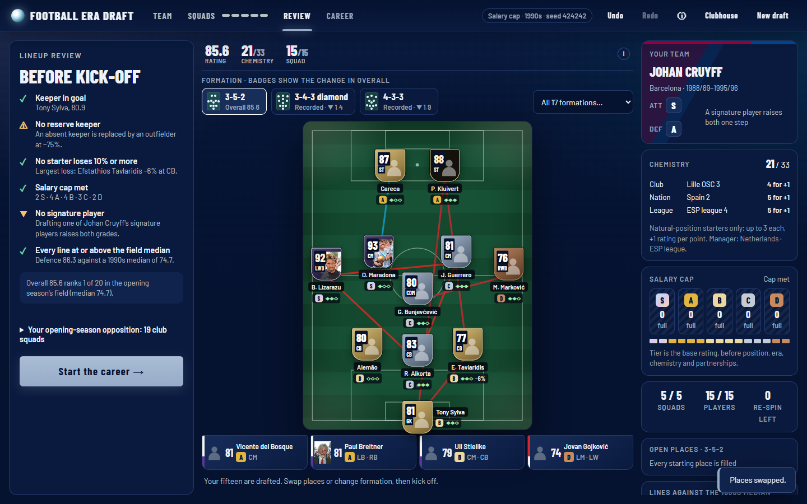
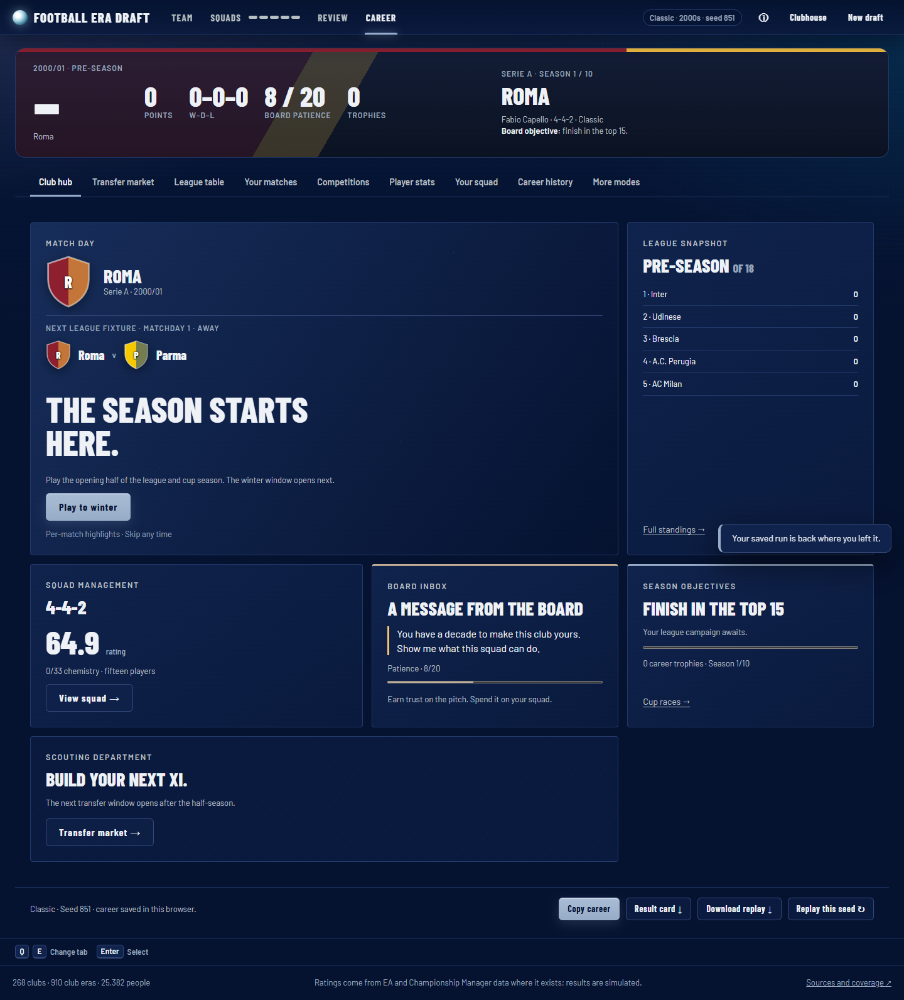

# Ball Knowledge

[Play in your browser](https://symonyeal.github.io/Ball-Knowledge/). The game uses bundled data and needs no account, API key, package installation or separate source downloads.



## What it is

- A football draft and career game. Draft fifteen players from different club eras under a tier-based salary cap, then replace a club's squad for the available seasons of a chosen decade.
- Career play includes domestic leagues, cups, transfers and board objectives.
- Modes: Career, Era Gauntlet, Weekly and Clubhouse, each with its own menu tile. Career and Gauntlet setup choose the decade, rules and replay seed.
- Design: the palette uses blue, gray and ecru combinations from Sanzo Wada. The shield cards and club crests use original styling.



## Draft

- Choose where the career takes place: one of eight decades, 1950s to 2020s. This sets the league seasons, opposition and conditions. The player draft stays open to every era. Random decade lets the replay seed choose; the seed has its own re-roll button.
- Manager draw: five managers, each paired with a recorded club spell that overlaps the decade and that club's real top-flight records. Two re-spins before keeping one. The manager has attacking and defensive grades; selecting one of his signature players improves them.
- Formation is chosen independently. The preview follows the selection and recorded formations are clickable. It can change during the draft or before kick-off, and sets the eleven starting positions to fill.
- Squad draw: five club squads, three players chosen from each. A squad belongs to a club and a decade, such as Napoli in the 1980s. Every available player from it appears in the roster. Click a player, then an empty place on the pitch or bench. One squad re-spin for the whole draft, usable before a pick from that draw.
- Any of the archive's 268 clubs can come up. Squads from decades near the season and stronger squads appear more often. No club appears twice in one draft.
- A footballer with several cards (different clubs or ages) is one person: choosing one card rules out the others.
- Once all fifteen places are filled, any two players can be swapped and the rating breakdown inspected before kick-off.
- Interface: choose an empty pitch position to shortlist players who fit it, or select a player first and compare his possible places. Arrow keys browse players and positions, Escape cancels a selection, R re-spins when available, Ctrl+Z undoes a lineup edit, Q/E changes career tabs. On phones the roster scrolls inside its panel. The header shows squad rating and chemistry.

## Salary cap

- A new draft uses a cap modelled on Eraball's Salary Cap Draft. Tiers by base rating: S at 90 or above, A from 85, B from 80, C from 75, D below.
- The fifteen must finish with exactly two S, four A, four B, three C and two D. Substitutes count. Eraball fills nine places with two S, two A, two B, two C and one D; the fifteen-place version is this game's adaptation.
- Example: Manchester United's 1970s squad includes George Best rated 90 and Bobby Charlton and Denis Law at A tier. If the two S and four A places are full, all three are blocked, and the roster says why.
- As in Eraball, every squad offers a player from the best tier still needed, starting with S, whenever a club not yet drafted from has one.
- A card is also blocked if taking it would leave too few affordable players at that club to finish the three picks from it.
- Classic removes tier limits and keeps the same draw rules.
- Full rules: [MODEL.md](docs/MODEL.md#the-salary-cap-limits-stars-across-the-whole-squad). Earlier automatic-policy measurements against the fictional twenty-club Era League are in [VALIDATION.md](docs/VALIDATION.md#draft-difficulty-varies-by-decade); they do not measure the real-league career.

## Ratings and chemistry

- A card is the player's version at a club and decade. The overall rating is the starting point; the assigned position changes the contribution.
- Example: the bundled Maradona card for Napoli in the 1980s has overall 91.2, attacking-midfield 91 and right-back 71. At right back he gives 71 before time and teammate adjustments. The browser shows the loss before placement.
- Position ratings come from EA FIFA/FC data or Championship Manager attributes converted to the same scale. Cards also show six attributes (pace, shooting, passing and others). Older cards without them use a simpler penalty based on distance from their listed positions. Position ratings only lower a player's value: in an unlisted position he always loses at least that distance penalty, so a position's shortlist holds only players who list it. Every card carries a source label.
- Era adjustment: older players lose 3% per decade moved forward in time; newer players lose 1.5% per decade moved back. Timeless tags reduce the loss. These are declared game rules, not a measure of how a real footballer would adapt.
- Chemistry, on EA FC Ultimate Team's scale: each starter in a listed position earns up to 3 points, each point adds one rating point, team maximum 33.
- Chemistry sources: former teammates (same club in the same seasons, at any club either played for), players who shared a club in other seasons, the same football nation, the same league, and a manager who coached the player. The pitch draws these bonds; the draft screen shows the rating chemistry adds and the win chance against a median opponent with and without it.
- Listed football partnerships earn a separate bonus when both start. The formation distributes the resulting ratings between attack, midfield and defence.
- Calculation and limits: [MODEL.md](docs/MODEL.md).

## Career seasons

- Your fifteen replace the chosen club's squad. Each season uses the domestic league's real clubs and league size, home-and-away fixtures and the period's two- or three-point win rule.
- A club outside the top flight that year takes the lowest-finishing real club's place. The league is the same throughout the career; relegation to a second division is not simulated.
- Seasons cover all available league seasons in the decade: the Bundesliga starts in 1963 and the supplied 2020s end with 2024/25.
- Opponents use players whose recorded club spells cover that season. A short squad can draw on the same club's nearest seasons within three years. If the archive still cannot supply a complete squad, a labelled stand-in uses generated players rated from the real club's points per game. Your players are removed from opposition squads. These fallbacks keep the league field complete and make squad evidence less exact than a season-by-season reconstruction.
- Domestic cups use that year's league clubs, with league cups and domestic super cups where the competition catalogue includes them.
- European places follow the previous season's results; the opening season uses historical league finishes and available European entrants. The European Cup becomes the Champions League, with Cup Winners' Cup and Fairs Cup/UEFA Cup/Europa League places where appropriate. Formats are simplified.
- Opening-season super cups are omitted because historical cup holders are missing; later seasons use your simulated holders. English clubs respect the 1985-89 European ban, with Liverpool also barred in 1990/91. Level ties go to extra time and penalties, no away-goals rule. Intercontinental and Club World Cup competitions are omitted because the archive lacks their full worldwide fields.
- Season flow: play to winter, play the run-in, make one summer change. The board compares each half's points with what the squad was expected to earn and applies Eraball's eight reward-and-punishment steps. At season end, meeting the league objective earns patience and improves the season's best player; missing it costs patience and weakens a disappointing player. Zero patience ends the career.
- Form: a win in which a player has three goal involvements, or every five clean sheets for a keeper, earns an **in-form** (+1 rating from the next half, up to +3, until season end). An **Evolution** sets one player an objective, such as 10 goals or 25 appearances; completing it adds 2 rating points and, for most, a new natural position.
- Summer window, one change: a signing (from the decade or next season's league rivals), a same-player card upgrade, a development card, or rest. A trophy that season makes the change free. The final season has no window. Ordinary prices rise as the career advances; negotiation terms, scouting re-spins and desperation offers carry the Eraball economy into the club career. Exact rules and competition limits: [MODEL.md](docs/MODEL.md#club-career).
- Match model: each side's attack, midfield, defence and goalkeeper give an expected goal total, and a score is drawn around it. Players can miss matches, starters tire, and the engine substitutes when a reserve offers more than a tired starter, so the four bench places matter beyond the headline rating.
- Calibration: goal calculations were fitted to real club results from 2014 to 2019 and checked on separate seasons from 2020 to 2023. That concerns modern club teams; era adjustments, manager grades and teammate bonuses are game rules.
- Goal and assist allocation uses recorded goals, assists, expected goals (xG, the chances a player had) and expected assists (xA, the chances his passes created). Where records are missing it falls back to other scoring records or position-based estimates. Scorer, assist and clean-sheet awards come from the simulated matches. What was tested: [VALIDATION.md](docs/VALIDATION.md).
- Match centre: each half-season lists results one match at a time (score, goal minutes, scorers and assists, extra time, penalties, two-leg aggregates, the standout and any in-form earned). Show all reveals the rest. Results are saved before playback, so closing or reloading keeps the season. Reduced motion shows every result at once. The standout reflects recorded goals and assists and grants no award.
- The Your matches tab keeps the cards for the whole season, split into opening half and run-in, with League and Cups filters. Career history keeps every match of completed seasons. Runs saved before goals were recorded show scores only.
- Career hub: next league fixture, standings, squad, board inbox, objectives and transfer market. Summer targets and outgoing players are selectable cards; the comparison shows the effect before a signing is confirmed. Formation and position swaps are in the Your squad tab between matches.

## Era Gauntlet

- Separate draft from the **Era Gauntlet** card, as in Eraball: choose a map, the usual rules and seed, then draft from squads within two decades of the map's first stop (2000s to 2020s for Odyssey in Reverse). Spins mostly land on each decade's strongest squads. The cap allows up to 3 S-tier and 6 A-tier players, other tiers free. Kick-off starts the run instead of a career. More modes also offers the Gauntlet to a squad drafted for the career.
- Routes: Odyssey in Reverse (default; all eight decades, 2020s back to the 1950s), The Full Odyssey (the other way), Original Gauntlet (1960s, 1990s, 2010s), Back in Time (that route reversed).
- Each decade: four six-match rounds against rising opposition, a reward after the second and fourth rounds, then a two-legged boss tie against one of its three strongest clubs, announced before the last round.
- Each cleared decade names its player, top scorer, assist leader, clean-sheet leader and biggest win; the run ends with the same honours for the whole run. Before each new decade the squad's ratings are shown for the decade left and the one ahead.
- Patience starts at 8, maximum 20. Good rounds earn more; poor rounds cost it. A boss win restores 4. The first boss loss in the run costs 4, every later loss 6. Surviving a loss restarts all four rounds of that decade against a different boss. The run ends at zero patience or when the route's last boss falls.
- Rewards: free agents, player or team development, rest. A prime-card boost upgrades a player to that person's highest-rated card in the archive. Development can improve the manager, strengthen partnerships, reduce position or era losses, or train a player's role. Ordinary prices rise as the run advances; below 5 patience, cut-price stars may offer a way back. Rest recovers 2 patience, then 1, then none when repeated.
- After each boss win before the final decade, a free transfer window offers players from the decade left and the one entered. Sign one from each and release two different squad members; the next decade starts at once. The re-rating table and goalkeeper warning appear in the window. Formation and two-place swaps are available between matches under Change the lineup.
- A capped run allows at most three S-tier and six A-tier charges across the fifteen; a boosted player keeps his original tier charge. The final score rewards cleared decades, round results and remaining patience, with a 1.5 multiplier under the cap.
- Prices, development catalogue, negotiation terms and score calculation: [MODEL.md](docs/MODEL.md#era-gauntlet). Gauntlet rounds and boss ties use the same match centre and cards; earlier decades have expandable round and boss records with no history cutoff.

## Other modes

- Tournament circuit (More modes): 10 to 20 events across the decades, rotating through an eight-club league, a European Cup, an eight-club knockout, groups followed by knockout, and a Super Cup. The squad is reassessed for each event's era. Completion shows titles and the circuit's leading scorer, assist provider, goalkeeper and player. Event pages list your matches, goals, deciding aggregates and league or group tables.
- Head to Head: exchange team codes with a friend. A code holds the exact cards, manager, formation, placement, decade and rules; both teams must use the same rules. Two legs, each team at home in its own era; a level aggregate goes to extra time and penalties in the second leg. Runs locally from the pasted codes.
- Weekly Challenge: the same draft seed and season decade for everyone, Monday to Sunday UTC, always under the salary cap. A seed is the number that fixes the random draws. Everyone starts with the same manager options and first squad; later draws depend on the tiers still needed, so picks steer which clubs appear. Twelve previous weekly challenges stay playable. No online leaderboard; codes and shared results are not authenticated records.
- Older season replays and sandbox seasons include your league and European Cup matches with the same goal details.

## Clubhouse

- The **Clubhouse** button opens account-free extras from any stage.
- Card browser: all 52,976 club-era cards by player, club, decade, position, tier or tag; inspect rating sources and pin up to three versions for comparison.
- Sandbox: choose any fifteen distinct players, change formation, manager and simulation era, fill empty places automatically, play a league and European Cup. Export a sandbox squad or send its Classic team code to a friend.
- Mini-games, daily puzzles and unlimited practice: guess an exact club-era card, compare overall ratings, recall a historical squad against a two-minute clock, identify clubs in a player's recorded career. Daily results and streaks survive reloads. Career Trail asks about the bundled archive, which can omit real club spells.
- Squad challenges: EA FC-style building puzzles in the sandbox. Reach a chemistry, squad rating, nation, league or decade target to unlock a reward card. Eight are permanent, three change each week. Drawing a squad deals its cards in, with a walkout when its best card is S or A tier.
- Lifetime statistics and personal records by mode and era. Identical seeded drafts and replays count once. Football achievements show requirements and progress; winning a trophy in a completed career season unlocks the exact club-era cards in that season's final squad. Sandbox experiments keep separate records.
- Preferences: day/night appearance, backdrops, motion, compact lists, default roster sorting, optional stadium ambience.
- Saving: progress stays in the browser used. **Settings → Export profile** backs up progress and the sandbox; **Download replay** backs up the active career or preserves choices to resume elsewhere; a result image can be downloaded to share. No accounts or shared online standings.
- Saved version 2 and version 3 drafts keep their original manager choices and fictional season, including club spells outside the new career's decade rule; older team codes still work. Start a new draft for the real-league career.
- A seed recreates the same draws when the same choices are made with the same data and engine. It does not record which players were chosen or where they were placed, and different picks lead to different later draws.

## Data

- The archive has 52,976 cards for 25,382 people, covering 910 club-and-decade squads from 268 clubs, and 96 managers. The five major leagues supply 185 of those clubs, up to twenty per league in each decade; [DATA.md](docs/DATA.md#a-decade-squad-covers-a-period-at-a-club) shows where records fall short, such as Germany before the Bundesliga.
- EA and Championship Manager provide much of the later-era rating evidence. The 1950s, 1960s and 1970s are almost entirely estimated. Earlier community databases are a pending source, not part of this release.
- Wikidata supplies club membership and dated spells. A decade squad can therefore contain players who never shared a season, miss players, or inherit incorrect dates. Whole-spell appearances and goals are divided over the covered years rather than observed per decade. The 2020s include only the years available in the sources.
- An EA or CM rating is that game's assessment. An estimated historical card is a model's prediction from later game ratings and recorded player facts. Neither is an objective ranking across football history. Source badges and the [coverage table](docs/DATA.md#coverage-by-decade) show where the evidence changes.

## Notebook

- The [Jupyter notebook](Ball%20Knowledge.ipynb) shares the browser's JavaScript rating and match functions. Its experiment plays one fictional twenty-club Era League and sixteen-club European Cup using decade-wide club squads. It does not reproduce the browser's real-league career, season-specific opponents, qualification or transfer economy.
- Python displays source coverage, a real card's position ratings, the chosen squad, rating adjustments, team strengths, fixtures, Cup ties and player awards.
- Settings: supply your own fifteen players, choose manager and formation, change the season decade, or compare placements. The default demonstration drafts under the salary cap, drawing five club squads and automatically picking three allowed players from each. In the browser every selection and placement is yours.
- The notebook prints the data hash and both random seeds, and checks that unchanged settings reproduce the result. Export happens only when `export_path` is set. Keeping exact browser cards and placement: [notebook settings](docs/MODEL.md#notebook-settings).

## Project layout

| File or folder | Contents |
| --- | --- |
| [index.html](index.html), [app/](app/main.js) | Static browser game and interface |
| [app/engine/](app/engine/index.js), [app/club.js](app/club.js), [app/career.js](app/career.js) | Rating and match calculations, real club-season competitions, career economy |
| [Ball Knowledge.ipynb](Ball%20Knowledge.ipynb), [notebooks/engine_bridge.mjs](notebooks/engine_bridge.mjs) | Squad experiments and the connection to the JavaScript engine |
| [data/game.json](data/game.json) | Cards, people, clubs, managers, match settings, real league records |
| [docs/DATA.md](docs/DATA.md) | Squad inclusion, source labels, coverage, attribution, rebuilding |
| [docs/MODEL.md](docs/MODEL.md) | Rating calculations, match rules, mode rules, notebook settings |
| [docs/VALIDATION.md](docs/VALIDATION.md) | Test commands, match-fit results, draft balance, limits of those checks |
| [pipeline/](pipeline/build.py), [tests/](tests/engine/game-data.test.mjs) | Python data preparation and automated checks |

## Execution

- Serve this folder and open [127.0.0.1:8765](http://127.0.0.1:8765/):

```text
py -3.14 -m http.server 8765 --bind 127.0.0.1
```

- No frontend build step. A static host needs `index.html`, `app/`, `data/game.json`, `data/portraits.json` and `data/portraits/`. GitHub Pages serves the repository from `main` at `/ (root)` using **Deploy from a branch** in Settings → Pages.
- Notebook: Node 20 or later and Python 3.11 or later.

```text
py -3.14 -m pip install -r requirements.txt
py -3.14 -m jupyterlab "Ball Knowledge.ipynb"
```

- `py -3.14` is the Windows development machine's system Python 3.14; elsewhere use your Python command. Set `NODE` in the notebook's setup cell if Node is not on PATH.
- Checks:

```text
node --test tests/engine/*.test.mjs
py -3.14 -m pip install -r requirements-analytics.txt
py -3.14 -m unittest discover -s tests -p test_pipeline.py -v
py -3.14 -m unittest discover -s tests -p test_wikidata.py -v
py -3.14 -m pytest -q
```

- GitHub's workflow also executes the notebook. Browser checks and balance commands: [VALIDATION.md](docs/VALIDATION.md). Rebuilding data: [DATA.md](docs/DATA.md).
- The [v1 tag](https://github.com/symonyeal/Ball-Knowledge/tree/v1) preserves the earlier Python game, notebook, career, rooms, mini-games and reports. Its saves and competitive profiles have a different format with no automatic migration, and its test commands apply to that version.

## Results

Measurements are in [docs/VALIDATION.md](docs/VALIDATION.md) and [docs/validation-2026-10-20.json](docs/validation-2026-10-20.json).

## Licence and attribution

- Code: [MIT](LICENSE). Bundled Barlow fonts: [SIL Open Font License](app/fonts/OFL.txt).
- Source data keeps its own terms, recorded in [DATA.md](docs/DATA.md#source-attribution-and-terms) and [data/manifest.json](data/manifest.json). Raw rating archives, CM databases and GPL results files remain local. Publisher declarations do not establish rights to every underlying game asset.
- Featured player and manager portraits are bundled from Wikimedia Commons, with [author and licence credits](docs/PORTRAITS.md). Other portraits load on demand; unavailable photographs show a silhouette. Photographs may show a different age or club from the card. No EA card artwork or club badges are bundled.
- Independent project, unaffiliated with Eraball, EA, FIFA, Konami, Wikidata or the data publishers.
