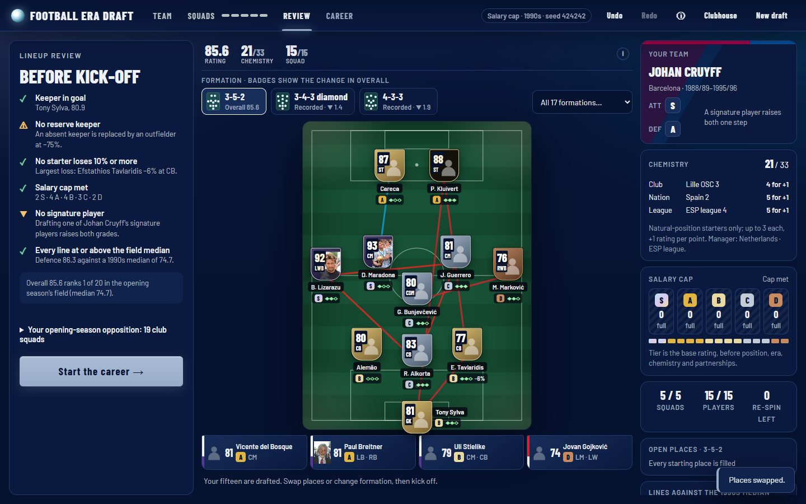
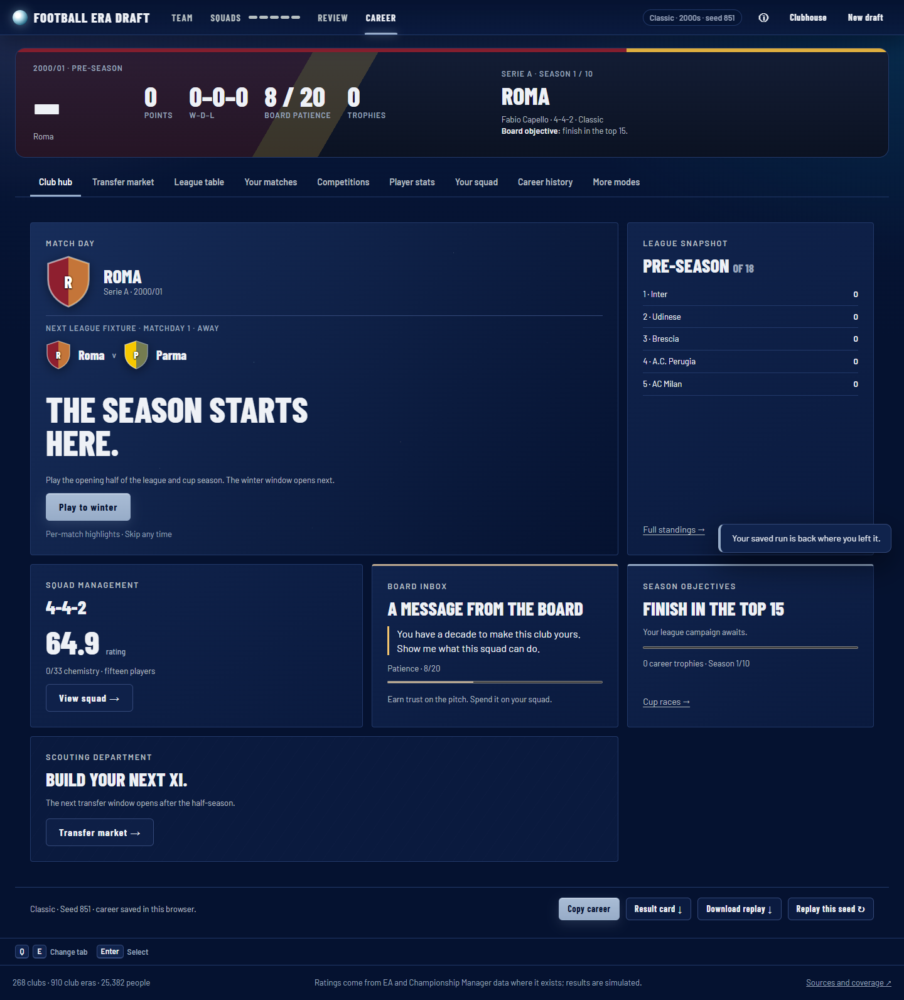

# Ball Knowledge

Ball Knowledge (formerly Football Era Draft) is a draft game about building a team across generations. Maradona's Napoli card can play alongside Messi's Barcelona card, but you still have to find a goalkeeper, fill your chosen formation, leave four useful substitutes on the bench and stay inside a salary cap that allows only two S-tier stars. Your fifteen then take your chosen club's place in its real domestic league for the available seasons of the decade, with cup races, transfer windows and a board that rewards or punishes your results.

[Play in your browser](https://symonyeal.github.io/Ball-Knowledge/). The game uses bundled data and needs no account, API key, package installation or separate source downloads.



## Choose your mode

Career, Era Gauntlet, Weekly and Clubhouse have their own menu tiles. Open Career or Gauntlet setup to choose the decade, rules and replay seed. The night-sky palette takes its blue, gray and ecru tones from Sanzo Wada combinations; the shield cards and club crests use original styling.

On the draft screen, choose an empty pitch position to shortlist players who fit it, or select a player first and compare his possible places. The pitch and substitutes use compact cards; the header shows squad rating and chemistry. Arrow keys browse players and positions, Escape cancels a selection, R re-spins when available, and Ctrl+Z undoes a lineup edit. Q/E changes career tabs.

The career hub brings together the next league fixture, standings, squad, board inbox, objectives and transfer market. Summer targets and outgoing players can be selected as cards; the comparison shows the effect before a signing is confirmed. Formation and position swaps sit in the Your squad tab between matches.

Each half-season opens a match centre that lists the half's results one match at a time: score, goal minutes, scorers and assists, extra time, penalties, two-leg aggregates, the standout and any in-form earned. Show all reveals the rest at once. Results are saved before playback starts, so closing or reloading keeps the same season. Reduced motion shows every result immediately. The Your matches tab keeps the same cards for the whole season, split into the opening half and the run-in, with League and Cups filters. The standout reflects recorded goals and assists; it grants no extra award. Gauntlet rounds and boss ties use the same match centre and cards; the run page lists the current decade's matches by round, with earlier rounds folded. Runs saved before goals were recorded show scores only.



## Five clubs supply your fifteen players

The **Clubhouse** button opens the account-free extras from any stage of the game. Browse all 52,976 club-era cards by player, club, decade, position, tier or tag; inspect their rating sources and pin up to three versions for comparison. Sandbox lets you choose any fifteen distinct players, change their formation, manager and simulation era, fill empty places automatically and play a league and European Cup. Export a sandbox squad or send its Classic team code to a friend.

Four mini-games offer daily puzzles and unlimited practice: guess an exact club-era card, compare overall ratings, recall a historical squad against a two-minute clock, or identify clubs in a player's recorded career. Daily results and streaks survive reloads. Career Trail asks about the bundled archive, which can omit real club spells. Twelve previous weekly challenges remain playable alongside the current week.

**Squad challenges** set EA FC-style building puzzles in the sandbox: reach a chemistry, squad rating, nation, league or decade target to unlock a reward card. Eight are permanent, and three change each week. Drawing a squad deals its cards in, with a walkout when its best card is S or A tier.

Lifetime statistics and personal records track completed games by mode and era. Identical seeded drafts and replays count once. Football achievements show their requirements and progress; winning a trophy in a completed career season unlocks the exact club-era cards in that season's final squad. Sandbox experiments keep separate records. Preferences include day/night appearance, backdrops, motion, compact lists, default roster sorting and optional stadium ambience. **Settings → Export profile** backs up this progress and the sandbox; use the existing **Download replay** control to back up the active career. There are no accounts or shared online standings.

Start by choosing where the career takes place: one of eight decades from the 1950s to the 2020s. This sets the league seasons, opposition and conditions your players will face. It leaves the player draft open to every era. Random decade lets your replay seed choose an era; the seed has its own re-roll button.

The first draw gives you five managers, each paired with a recorded club spell that overlaps your decade and that club's real top-flight records. You can re-spin twice before keeping one. Choose the formation independently: the preview follows your selection, and recorded formations are clickable. Change it during the draft or before kick-off; it sets the eleven starting positions you must fill. The manager has attacking and defensive grades, and selecting one of his signature players improves those grades.

Then you draw five club squads and choose three players from each. A squad belongs to a club and a decade, such as Napoli in the 1980s. Every available player from that squad appears in the roster. Click a player, then an empty place on the pitch or bench. You have one squad re-spin for the whole draft, usable before making a pick from that draw.

This makes each selection depend on what the team still needs. Three outstanding forwards from the first club may leave you looking for defenders later. A reserve goalkeeper costs a place that could have gone to another attacker, but gives you cover when the starter misses a match. Any of the archive's 268 clubs can come up. Squads from decades near your season and stronger squads appear more often, and no club appears twice in one draft.

A footballer may have several cards at different clubs or ages. Those cards are versions of the same person, so choosing one rules out the others during the draft. Once all fifteen places are filled, you can swap any two players and inspect the rating breakdown before kick-off.

## The salary cap makes every star a choice

A new draft uses a salary cap modelled on Eraball's Salary Cap Draft. Every card has a tier set by its base rating: S at 90 or above, A from 85, B from 80, C from 75 and D below that. Your fifteen must finish with exactly two S-tier players, four A, four B, three C and two D. Substitutes count, so a star cannot be parked on the bench for free. Eraball fills nine places with two S, two A, two B, two C and one D; the fifteen-place version is this game's adaptation.

For example, Manchester United's 1970s squad includes George Best rated 90 and Bobby Charlton and Denis Law at A tier. If your two S and four A places are already full, all three are blocked, and the roster says why.

As in Eraball, every squad offers a player from the best tier you still need, starting with S, whenever a club you have not drafted from has one. A card is also blocked if taking it would leave too few affordable players at that club to finish your three picks from it. Test drafts that saved the S places for last, or took the cheapest players first, always finished.

Classic removes tier limits while keeping the same draw rules. The [model document](docs/MODEL.md#the-salary-cap-limits-stars-across-the-whole-squad) gives the full cap rules. [Validation](docs/VALIDATION.md#draft-difficulty-varies-by-decade) retains the earlier automatic-policy measurements against the fictional twenty-club Era League as a legacy benchmark; those title rates do not measure the real-league career.

## The card belongs to a player, a club and a decade

The club and decade matter because the game uses the version of a player recorded there. An overall rating gives a starting point; the position you assign him changes the contribution he can make.

The bundled Maradona card for Napoli in the 1980s has an overall rating of 91.2, an attacking-midfield rating of 91 and a right-back rating of 71. Putting him at right back therefore gives you 71 before time and teammate adjustments. His name and overall rating do not erase that positional cost. The browser shows the loss before you place him.

Where available, these position ratings come from EA FIFA/FC data or Championship Manager attributes converted to the same rating scale. Cards also show six attributes, such as pace, shooting and passing, so you can see their strengths and weaknesses. Older cards without those measurements use a simpler penalty based on the distance from their listed positions. Position ratings can only lower a player's value: in a position he does not list, he always loses at least that distance penalty, so the shortlist for a position holds only players who list it. Every card carries a source label.

Taking a player out of his own era applies another adjustment. Older players lose 3% per decade when moved forward in time; newer players lose 1.5% per decade when moved back. Timeless tags reduce that loss. These are declared game rules, intended to make the choice of era affect the draft. They do not measure how a real footballer would adapt to another generation.

Chemistry can recover some points. On EA FC Ultimate Team's scale, each starter in a listed position earns up to 3 chemistry points, and each point adds one rating point; the team maximum is 33. The points come from real careers: former teammates (the same club in the same seasons, at any club either played for), players who shared a club in other seasons, the same football nation, the same league, and a manager who coached the player. The pitch draws those bonds, and the draft screen shows the rating chemistry adds and the win chance against a median opponent with and without it. Listed football partnerships earn a separate bonus when both start. The formation distributes the resulting ratings between attack, midfield and defence. Moving a player can therefore affect his own rating, the team's chemistry and the balance of the team. The [model document](docs/MODEL.md) gives the complete calculation and its limits.

## Lead your club through the decade

Your drafted fifteen replace your chosen club's squad. Each season uses its domestic league's real clubs and league size, with home-and-away fixtures and the period's two- or three-point win rule. If your club was outside the top flight that year, it takes the lowest-finishing real club's place. You keep the same league throughout the career; the game does not simulate relegation to a second division. Careers cover all available league seasons in the decade: the Bundesliga starts in 1963, and the supplied 2020s end with 2024/25.

Opponents use players whose recorded club spells cover that season. A short squad can draw on the same club's nearest seasons within three years. Where the archive still cannot supply a complete squad, a labelled stand-in uses generated players rated from the real club's points per game. Your players are removed from opposition squads so they cannot face themselves. These fallbacks keep the real league field complete; they also make the squad evidence less exact than a season-by-season historical reconstruction.

Domestic cups use that year's league clubs, with league cups and domestic super cups where the competition catalogue includes them. European places follow the previous season's results; the opening season uses historical league finishes and available European entrants. The European Cup becomes the Champions League, with Cup Winners' Cup and Fairs Cup/UEFA Cup/Europa League places where appropriate. The formats are simplified. Opening-season super cups are omitted because historical cup holders are missing; later seasons use your simulated holders. English clubs respect the 1985–89 European ban, with Liverpool also barred in 1990/91. Level ties go to extra time and penalties, with no away-goals rule. Intercontinental and Club World Cup competitions are omitted because the archive lacks their full worldwide fields.

Play to winter, play the run-in, then make one summer change. The board compares each half's points with what the squad was expected to earn and applies Eraball's eight reward-and-punishment steps. At season end, meeting the league objective earns patience and improves the season's best player; missing it costs patience and weakens a disappointing player. Zero patience ends the career.

Two EA FC Ultimate Team mechanics reward form. A win in which a player has three goal involvements, or every five clean sheets for a keeper, earns an **in-form**: +1 rating from the next half, up to +3, until the season ends. An **Evolution** sets one player an objective, such as 10 goals or 25 appearances; completing it adds 2 rating points and, for most evolutions, a new natural position.

The summer window allows one change: a signing (from the decade or next season's league rivals), a same-player card upgrade, a development card, or rest. A trophy that season makes the change free. The final season has no window. Ordinary prices rise as the career advances; negotiation terms, scouting re-spins and desperation offers carry the Eraball economy into the club career. [MODEL.md](docs/MODEL.md#club-career) states the exact rules and competition limits.

The match model compares each side's attack, midfield, defence and goalkeeper to calculate an expected goal total. It then draws a score around that expectation. A stronger team is favoured, but can lose an individual match. Players can miss matches, starters tire, and the engine makes substitutions when a reserve offers more than a tired starter. This gives the four bench places a job beyond raising the headline squad rating.

The model's goal calculations were fitted to real club results from 2014 to 2019 and checked on separate seasons from 2020 to 2023. That check concerns modern club teams. The era adjustments, manager grades and teammate bonuses remain game rules, and the fit does not establish that a mixed-era eleven has a historically correct strength.

Recorded goals, assists and expected goals also help choose who receives a simulated goal or assist. Expected goals, or xG, describe the chances a player had; expected assists, or xA, describe the chances his passes created. The game uses those records where they exist and falls back to other scoring records or position-based estimates. The scorer, assist and clean-sheet awards in your results come from the matches that were simulated. [Validation](docs/VALIDATION.md) explains what was tested and what the measurements can support.

## The Gauntlet develops the team you drafted

The **Era Gauntlet** card on the start screen opens a separate draft for it, as in Eraball: choose a map and the usual rules and seed, then draft from squads within two decades of the map's first stop (the 2000s to the 2020s for Odyssey in Reverse). The spins mostly land on each decade's strongest squads, and the salary cap allows up to 3 S-tier and 6 A-tier players with the other tiers free, so the fifteen can stand up to a decade's best clubs. Kick-off starts the run instead of a career. More modes also offers the Gauntlet to a squad drafted for the career. Choose one of four routes. The default, Odyssey in Reverse, visits all eight decades from the 2020s back to the 1950s; The Full Odyssey travels the other way. Original Gauntlet visits the 1960s, 1990s and 2010s, and Back in Time reverses that route. Each decade has four six-match rounds against rising opposition, with a reward after the second and fourth rounds, then a two-legged boss tie against one of its three strongest clubs, announced before the last round. Each cleared decade names its player, top scorer, assist leader, clean-sheet leader and biggest win, and the run ends with the same honours for the whole run. Before each new decade the squad's ratings are shown for the decade left and the one ahead.

The board starts with 8 patience, with a maximum of 20. Good rounds earn more; poor rounds cost it. Winning a boss restores 4 patience. The first boss loss in the run costs 4, and every later loss costs 6. Surviving a loss restarts all four rounds of that decade against a different boss. The run ends at zero patience or when the route's last boss falls.

Rewards offer free agents, player or team development, and rest. A prime-card boost upgrades an existing player to that same person's highest-rated card in the archive. Development can improve the manager, strengthen partnerships, reduce position or era losses, or train a player's role. Ordinary prices rise as the run advances; below 5 patience, cut-price stars may offer a way back. Rest recovers 2 patience, then 1, then none when repeated.

After each boss win before the final decade, a free transfer window offers players from the decade you leave and the one you enter. Sign one from each and release two different squad members; the next decade starts at once. The re-rating table and goalkeeper warning appear in the window. Formation and two-place swaps are available between matches under Change the lineup. A capped run allows at most three S-tier and six A-tier charges across the fifteen; a boosted player keeps his original tier charge. The final score rewards cleared decades, round results and remaining patience, with a 1.5 multiplier under the cap. [MODEL.md](docs/MODEL.md#era-gauntlet) gives the prices, development catalogue, negotiation terms and score calculation.

## Take the same squad into other competitions

More modes also contains the tournament circuit and Head to Head. The circuit plays 10 to 20 events across the decades. It rotates through an eight-club league, a European Cup, an eight-club knockout, groups followed by knockout, and a Super Cup. The squad is reassessed for the era of each event. Completion shows your titles and the circuit's leading scorer, assist provider, goalkeeper and player.

Head to Head lets you exchange team codes with a friend. A code contains the exact cards, manager, formation, placement, decade and rules, and both teams must use the same rules. The game plays two legs, with each team at home in its own era; a level aggregate goes to extra time and penalties in the second leg. It runs locally from the codes you paste.

The Weekly Challenge gives everyone the same draft seed and season decade for the week, from Monday to Sunday in UTC, always under the salary cap. A seed is the number that fixes the random draws. Everyone starts with the same manager options and the same first squad. After that, each draw must suit the tiers you still need, so your own picks steer which clubs you meet. There is no online leaderboard, and codes or shared results are not authenticated competitive records.

Progress stays in the browser you used. Download a replay to preserve your choices and resume them elsewhere, or download a result image to share. Saved version 2 and version 3 drafts retain their original manager choices and fictional season, including club spells outside the new career's decade rule; older team codes still work. Start a new draft for the real-league career. A seed recreates the same draws when the same choices are made with the same data and engine. It does not record which players you chose or where you placed them, and different picks lead to different later draws.

## The historical archive is uneven

The supplied archive has 52,976 cards for 25,382 people, covering 910 club-and-decade squads from 268 clubs, and 96 managers. The five major leagues supply 185 of those clubs, up to twenty per league in each decade; [DATA.md](docs/DATA.md#a-decade-squad-covers-a-period-at-a-club) shows where the records fall short, such as Germany before the Bundesliga. EA and Championship Manager provide much of the later-era rating evidence. The 1950s, 1960s and 1970s remain almost entirely estimated. Earlier community databases are a pending source of evidence, not part of this release.

Wikidata supplies club membership and dated spells at a club. A decade squad can therefore contain players who never shared one season. It can also miss players or inherit incorrect dates. Whole-spell appearances and goals are divided over the covered years rather than observed separately for each decade. The 2020s include only the years available in the sources.

An EA or CM rating is that game's assessment. An estimated historical card is a model's prediction from later game ratings and recorded player facts. Neither establishes an objective ranking across football history. Source badges and the [coverage table](docs/DATA.md#coverage-by-decade) let you see where the evidence changes.

## Inspect the choices in the notebook

The [Jupyter notebook](Ball%20Knowledge.ipynb) shares the browser's JavaScript rating and match functions. Its existing experiment plays one fictional twenty-club Era League and sixteen-club European Cup, using decade-wide club squads. It does not reproduce the browser's real-league career, season-specific opponents, qualification or transfer economy. Python displays the data and results: source coverage, a real card's position ratings, the chosen squad, rating adjustments, team strengths, fixtures, Cup ties and player awards.

You can supply your own fifteen players, choose a manager and formation, change the season decade, or compare the same lineup with different placements. The default demonstration drafts under the salary cap: it draws five club squads and automatically picks three allowed players from each. In the browser, every selection and placement is yours. The notebook also prints the data hash and both random seeds, then checks that unchanged settings produce the same result.

The [notebook settings reference](docs/MODEL.md#notebook-settings) explains how to retain exact browser cards and placement. Exporting a notebook result is optional and happens only when you set `export_path`.

## Project files and running your own copy

| File or folder | What to use it for |
| --- | --- |
| [index.html](index.html), [app/](app/main.js) | The static browser game and its interface. |
| [app/engine/](app/engine/index.js), [app/club.js](app/club.js), [app/career.js](app/career.js) | Rating and match calculations, real club-season competitions and the career economy. |
| [Ball Knowledge.ipynb](Ball%20Knowledge.ipynb), [notebooks/engine_bridge.mjs](notebooks/engine_bridge.mjs) | Editable squad experiments and the connection to the JavaScript engine. |
| [data/game.json](data/game.json) | The bundled cards, people, clubs, managers, match settings and real league records. |
| [docs/DATA.md](docs/DATA.md) | Squad inclusion, source labels, coverage, attribution and rebuilding. |
| [docs/MODEL.md](docs/MODEL.md) | Rating calculations, match rules, mode rules and notebook settings. |
| [docs/VALIDATION.md](docs/VALIDATION.md) | Test commands, match-fit results, draft balance and the limits of those checks. |
| [pipeline/](pipeline/build.py), [tests/](tests/engine/game-data.test.mjs) | Python data preparation and the automated checks. |

To run the game locally, serve this repository folder and open [127.0.0.1:8765](http://127.0.0.1:8765/):

```text
py -3.14 -m http.server 8765 --bind 127.0.0.1
```

There is no frontend build step. A static host needs `index.html`, `app/`, `data/game.json`, `data/portraits.json` and `data/portraits/`. GitHub Pages serves this repository from `main` at `/ (root)` using **Deploy from a branch** in Settings → Pages.

For the notebook, install Node 20 or later and Python 3.11 or later, then run:

```text
py -3.14 -m pip install -r requirements.txt
py -3.14 -m jupyterlab "Ball Knowledge.ipynb"
```

These commands use the Windows development machine's system Python 3.14. Elsewhere, replace `py -3.14` with your Python command. Set `NODE` in the notebook's setup cell if Node is not on PATH.

To check an edited copy:

```text
node --test tests/engine/*.test.mjs
py -3.14 -m pip install -r requirements-analytics.txt
py -3.14 -m unittest discover -s tests -p test_pipeline.py -v
py -3.14 -m unittest discover -s tests -p test_wikidata.py -v
py -3.14 -m pytest -q
```

GitHub's workflow also executes the notebook. Browser checks and balance commands are in [VALIDATION.md](docs/VALIDATION.md); rebuilding data is a separate task described in [DATA.md](docs/DATA.md).

The [v1 tag](https://github.com/symonyeal/Ball-Knowledge/tree/v1) preserves the earlier Python game, notebook, career, rooms, mini-games and reports. Its saves and competitive profiles have a different format and no automatic migration. Its test commands apply to that version.

The [code licence](LICENSE) is MIT. Bundled Barlow fonts use the [SIL Open Font License](app/fonts/OFL.txt). Source data retains its own terms; [DATA.md](docs/DATA.md#source-attribution-and-terms) and [data/manifest.json](data/manifest.json) record them. Raw rating archives, CM databases and GPL results files remain local. Publisher declarations do not establish rights to every underlying game asset. Featured player and manager portraits are bundled from Wikimedia Commons, with [author and licence credits](docs/PORTRAITS.md). Other player portraits load on demand; unavailable photographs show a silhouette. Photographs may show a different age or club from the historical card. No EA card artwork or club badges are bundled. This independent project is unaffiliated with Eraball, EA, FIFA, Konami, Wikidata or the data publishers.
